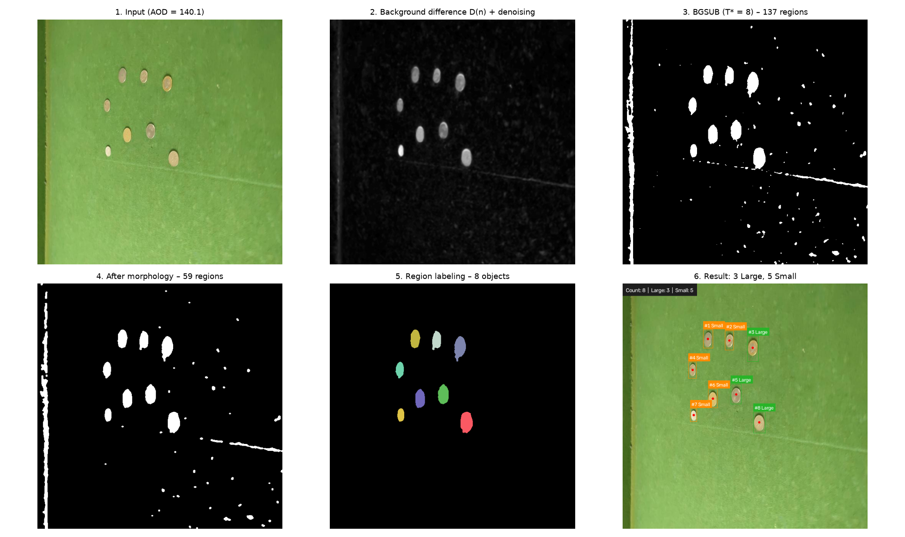
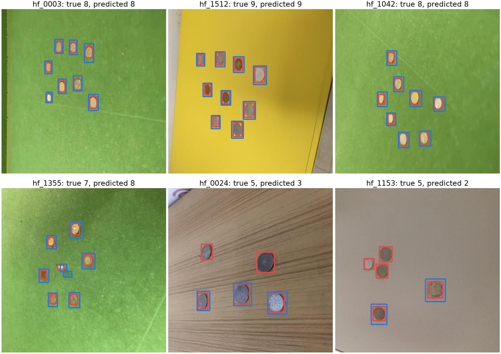
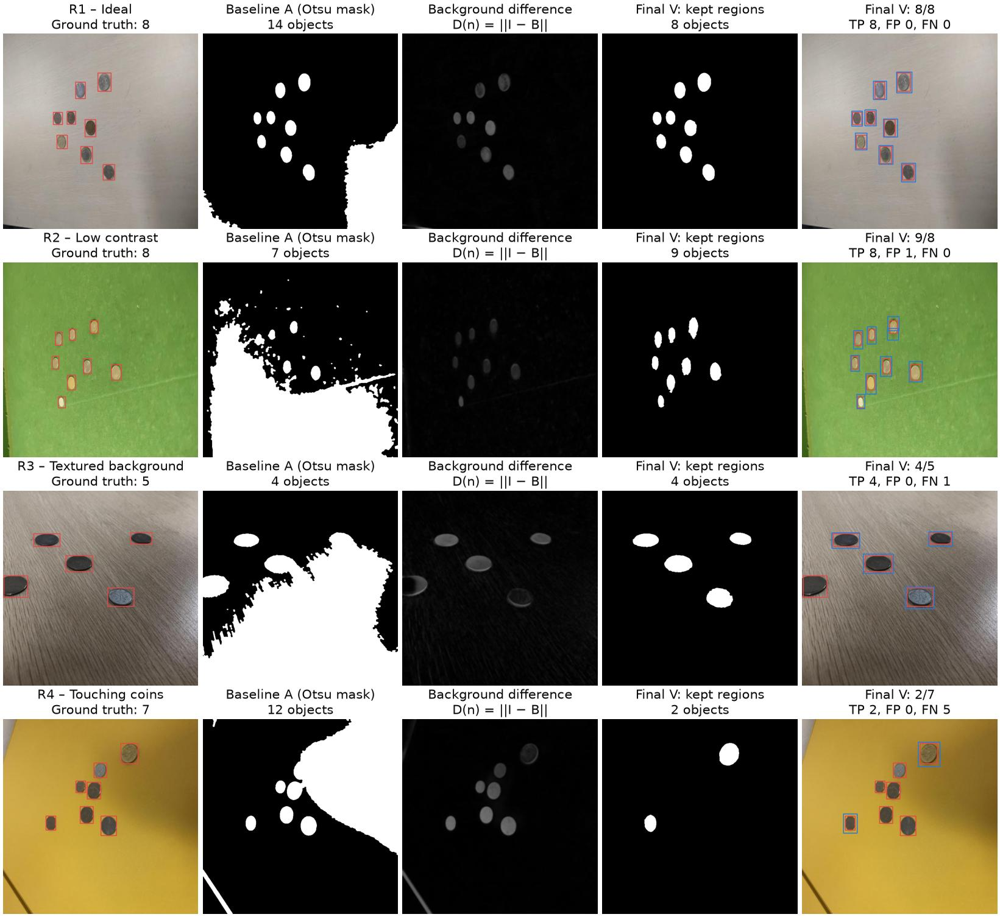
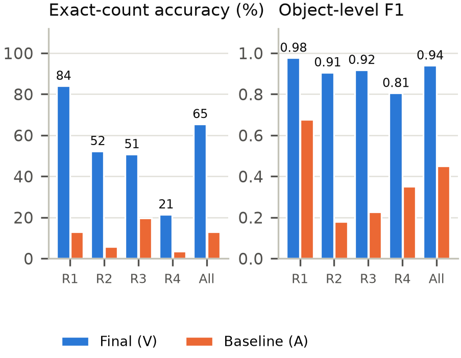
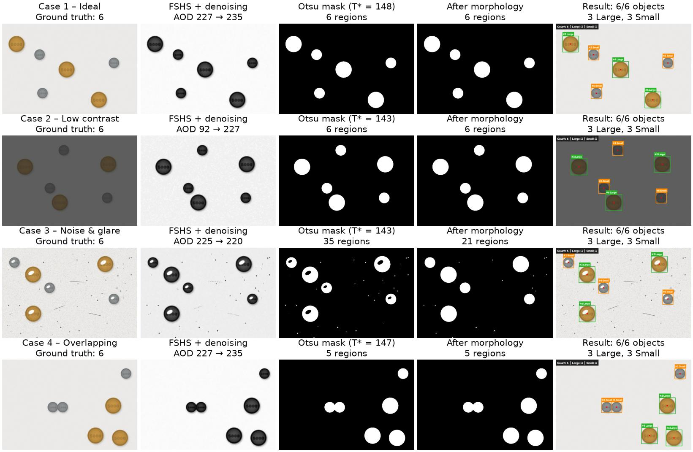

# IMP302m – Object Counting and Size Classification with Classical Image Processing

Course project for **IMP302m – Image and Video Processing**, FPT University.

The system separates discrete objects (coins) from a static background, counts them, measures their geometry and classifies them as **Large / Small**.
The pipeline is **training-free** and uses only classical image processing. The core algorithms are **implemented from scratch in NumPy** and verified to match OpenCV.

**Team**

| Member | Email |
|---|---|
| Ngô Quang Huy | ngoquanghuy2k5@gmail.com |
| Nguyễn Đức Mạnh | Manhndse180326@fpt.edu.vn |
| Hoàng Văn Anh | anhhvse180142@fpt.edu.vn |

IEEE-format report: [`report/main.tex`](report/main.tex). See [`report/README.md`](report/README.md) for how to compile it.

---

## Main results

### 4 synthetic cases (pixel-exact ground-truth masks)

| Case | Challenge | Count | Large / Small | Mask IoU |
|---|---|---|---|---|
| Case 1 – Ideal | Uniform bright background, separated objects | 6 / 6 | 3 / 3 ✓ | 0.972 |
| Case 2 – Low contrast | Gray levels squeezed into [30, 100] | 6 / 6 | 3 / 3 ✓ | 0.971 |
| Case 3 – Noise & glare | Salt-and-pepper noise, glare spots | 6 / 6 | 3 / 3 ✓ | 0.961 |
| Case 4 – Overlapping | Two objects overlapping | 6 / 6 | 3 / 3 ✓ | 0.972 |

### 4 real-image cases (480 test images, 3,386 coins)

The photos come from the Roboflow 100 *coins* dataset. Each image is assigned to a case using only its ground-truth labels and image statistics (`tools/real_cases.py`), never the algorithm output.

| Case | Images | Baseline (A): exact count / F1 | **Final (V): exact count / F1** |
|---|---|---|---|
| R1 – Ideal | 232 | 12.9% / 0.676 | **84.1% / 0.977** |
| R2 – Low contrast | 88 | 5.7% / 0.181 | **52.3% / 0.906** |
| R3 – Textured background | 132 | 19.7% / 0.226 | **50.8% / 0.918** |
| R4 – Touching coins | 28 | 3.6% / 0.351 | **21.4% / 0.805** |
| **All** | **480** | 12.9% / 0.450 | **65.4% / 0.940** |

On the whole test split, the final configuration V reaches:
- a count within ±1 on 84.2% of the images;
- a mean absolute counting error (MAE) of 0.77 coins per image;
- Precision 0.921 and Recall 0.959.

It runs at about **65 ms per 640×640 image** with OpenCV, or about 197 ms with the from-scratch NumPy version.
All parameters were selected on the **dev** split; the **test** split was run only once.

---

## Demo on real photos

### The real-image pipeline step by step

Test image `hf_0003`: all 8 coins found. The background-difference image D(n) separates the coins from the green mat; morphology, border clearing and the shape filter remove the mat texture and the table edge.



The Large/Small labels on real photos are only illustrative: the dataset has no size labels, so classification is evaluated on the synthetic images.

### Successes and failures

Randomly chosen test images. **Red** = ground-truth box, **blue** = prediction.
Top row: correct counts on a green mat and on yellow paper. Bottom row:
- `hf_1355`: one small coin breaks into two fragments, giving one extra detection.
- `hf_0024`: two coins on wood grain are missed. One merges with the grain into an irregular region (circularity 0.23); the other has circularity 0.59, just below the 0.6 threshold.
- `hf_1153`: three close coins merge into one region (circularity 0.32). This is too irregular to be split by watershed, and the shape filter then rejects it.



### The 4 real-image cases: baseline vs final configuration

One random test image per case (R1–R4). Columns:
1. input with ground truth;
2. baseline Otsu mask, which floods the non-uniform background;
3. difference image D(n);
4. regions kept by configuration V;
5. final detections.



<p align="center">
  
</p>

### Synthetic cases



More results for every image (histograms, masks, morphology steps, feature tables) are in [`outputs/`](outputs/).

---

## Pipeline

```
Color image ─► Stage 1 Preprocessing ─► Stage 2 Segmentation ─► Stage 3 Labeling & features ─► Stage 4 Classification
               resize, gray,            Otsu / K-Means,          two-pass + union-find,         1-D Otsu on areas
               FSHS, median,            opening, closing,        A_min filter, watershed,       → Large / Small
               Gaussian                 hole filling             area, perimeter, ...
```

**Real-image branch** (`--preset real`) replaces Stage 2 with a change-detection approach:
1. Estimate the background B with a large-window median filter.
2. Compute the difference image D = ‖I − B‖ in Lab color space and threshold it with the Triangle method.
3. Remove regions touching the image border.
4. Split touching objects with watershed, applied only to sufficiently round regions.
5. Filter regions by shape and area.

**Verification of the from-scratch implementations** (`tools/verify_impl.py`, on the Case 3 image):

| Algorithm | Result compared with OpenCV |
|---|---|
| 5×5 median filter | max difference = 0 |
| 5×5 Gaussian filter | max difference = 1 gray level |
| Otsu threshold | same T* = 186 |
| Erosion, dilation | identical |
| 4- and 8-connected labeling | same 35 regions, same partition |

---

## Installation

Requires Python ≥ 3.10.

```powershell
# Windows (PowerShell)
python -m venv .venv
.\.venv\Scripts\python.exe -m pip install -r requirements.txt
```

```bash
# Linux / macOS
python3 -m venv .venv && source .venv/bin/activate
pip install -r requirements.txt
```

The commands below are written for Windows. On Linux/macOS, replace `.\.venv\Scripts\python.exe` with `python` and `\` with `/`.

## Quick start

```powershell
# 4 synthetic cases (already in the repository; this re-creates them)
.\.venv\Scripts\python.exe tools\generate_synthetic.py

# Run the pipeline on a folder: reads ground_truth.json automatically and prints an evaluation table
.\.venv\Scripts\python.exe main.py data\synthetic --out outputs\synthetic

# Real photos: final configuration V on the test split
.\.venv\Scripts\python.exe main.py data\real\hf_coins --preset real --subset test --save minimal --backend opencv --out outputs\real_test

# Any single image
.\.venv\Scripts\python.exe main.py path\to\image.jpg --out outputs\my_image
```

Common options (full list: `python main.py -h`):

| Option | Meaning |
|---|---|
| `--method otsu\|kmeans\|bgsub` | Segmentation algorithm |
| `--preset real` | Final configuration V for real photos |
| `--classify otsu\|mean\|gap` | How the Large/Small area threshold is chosen |
| `--area-threshold N` | Use a fixed area threshold (px) |
| `--backend numpy\|opencv` | Own implementations or OpenCV (same results, OpenCV is faster) |
| `--no-split`, `--no-fill`, `--flatten` | Disable watershed / disable hole filling / enable illumination flattening |
| `--save all\|minimal\|none` | How many output figures are saved |
| `--subset dev\|test`, `--limit N` | Run on a subset |

## Reproducing all experiments and report figures

```powershell
# 1. Download the real photos (~56 MB, not in the repository), then filter them and split dev/test.
#    data\real\hf_coins is already in the repository; this step is only needed to rebuild it from scratch.
New-Item -ItemType Directory -Force data\downloads\hf_coins
curl.exe -L -o data\downloads\hf_coins\test.parquet https://huggingface.co/datasets/Francesco/coins-1apki/resolve/main/data/test-00000-of-00001-83ed470261ddf492.parquet
.\.venv\Scripts\python.exe tools\import_hf_coins.py

# 2. Assign the real photos to cases R1–R4
.\.venv\Scripts\python.exe tools\real_cases.py

# 3. Compare configurations: select on dev, confirm on test
.\.venv\Scripts\python.exe tools\experiment_real.py data\real\hf_coins dev
.\.venv\Scripts\python.exe tools\experiment_real.py data\real\hf_coins test A,C,G,N,V,X

# 4. Verify the own implementations against OpenCV
.\.venv\Scripts\python.exe tools\verify_impl.py

# 5. Regenerate every figure, chart and number of the report (~5 minutes)
.\.venv\Scripts\python.exe tools\make_report_figures.py

# 6. Pack the report for Overleaf
.\.venv\Scripts\python.exe tools\make_overleaf_zip.py
```

---

## Repository layout

```
ipm/                    Image-processing library
  config.py             All parameters (Config dataclass)
  preprocess.py         Stage 1: NN resize, RGB→gray, histogram, AOD, FSHS, median, Gaussian, background difference
  segmentation.py       Stage 2: Otsu, K-Means k=2, Triangle, MAD, bright/dark background detection
  morphology.py         Stage 2: erosion, dilation, opening, closing, hole filling
  labeling.py           Stage 3: two-pass labeling + union-find, A_min filter, border clearing
  split.py              Stage 3: distance transform + watershed for touching objects
  features.py           Stage 3: area, centroid, perimeter, diameter, orientation, circularity, solidity
  classify.py           Stage 4: Large/Small area threshold
  pipeline.py           Runs the stages and times them
  evaluate.py           Comparison with ground truth: count, P/R/F1, IoU
  visualize.py          Output figures
main.py                 Command-line interface
tools/
  generate_synthetic.py  Generates the 4 synthetic cases with ground-truth masks
  import_hf_coins.py     Filters the real dataset and splits dev/test
  real_cases.py          Assigns real photos to R1–R4
  experiment_real.py     Configuration comparison table (ablation)
  verify_impl.py         Compares own implementations with OpenCV
  make_report_figures.py Generates the report figures and charts
  make_overleaf_zip.py   Packs main.tex + figures/ for Overleaf
  fetch_public.py        Saves skimage.data.coins()
data/
  synthetic/            4 synthetic images + ground_truth.json + gt/ (masks)
  real/hf_coins/        960 real photos + ground_truth.json (boxes) + split.json (dev/test)
  public/               skimage coins image
outputs/                Sample results (see below)
report/
  main.tex              IEEE report
  figures/              12 figures and charts
  data/                 Raw numbers behind every table and chart
```

### Outputs per image (`outputs/<folder>/<image name>/`)

| File | Content |
|---|---|
| `00_pipeline_overview.png` | All pipeline steps in one figure |
| `01_histogram_fshs.png`, `01b_fshs_vs_threshold.png` | Histograms before/after FSHS; fixed threshold vs Otsu |
| `02_mask_raw.png`, `02_mask_clean.png`, `02b_morphology_steps.png` | Binary masks and each morphology step |
| `02c_otsu_vs_kmeans.png` | Otsu vs K-Means |
| `03_label_map.png` | Label map |
| `04_detection.png` | Bounding boxes, centroids, IDs, Large/Small class |
| `05_features.csv` | Feature table of every object |
| `summary.json` | Parameters, timings, results |

Each folder also has a `summary.csv` that collects all its images. Folders included in the repository:
- `outputs/synthetic/`: results on the 4 synthetic cases.
- `outputs/case4_nosplit/`: Case 4 with watershed disabled.
- `outputs/real_showcase/`: 8 sample real photos.
- `outputs/experiment_*.txt|json`: configuration comparison tables on dev and test.

---

## Data

**Synthetic images** (`data/synthetic/`): generated by `tools/generate_synthetic.py` with exact ground truth. The masks are pixel-exact, so IoU can be computed.

**Real photos** (`data/real/hf_coins/`): the [coins-1apki](https://universe.roboflow.com/object-detection/coins-1apki) dataset from Roboflow 100 ([Hugging Face copy](https://huggingface.co/datasets/Francesco/coins-1apki)), license **CC BY 4.0**.
- Taken from the *test* split of the original dataset; 960 images that contain only coins, 3–30 coins each, are kept.
- Randomly split into dev 480 / test 480 with seed 2026.
- Labels contain only the count and bounding boxes, **no Large/Small labels**. On real photos, only counting and localization can therefore be evaluated.

**Self-captured photos** (recommended, to evaluate Large/Small classification on real images):
- Put the images in `data/raw/` with a `data/raw/ground_truth.json` such as `{"img_01.jpg": {"count": 6, "large": 3, "small": 3}}`.
- Hold the phone parallel to the table, 30–40 cm away, with the flash off.
- Use white paper or black cloth as the background.
- Choose 2 groups of objects whose areas differ by at least 1.3×, e.g. 5000 VND and 500 VND coins.
- Capture all 4 cases:

| Case | How to create it |
|---|---|
| Case 1 – Ideal | Uniform lighting, objects at least 1 cm apart |
| Case 2 – Low contrast | Turn off the ceiling light or lower the exposure (EV −2) |
| Case 3 – Noise & glare | Sprinkle paper crumbs on the background, shine a flashlight at an angle to create glare |
| Case 4 – Overlapping | Place 2–3 pairs of objects touching or overlapping |

---

## Known limitations

- Clusters of 3 or more touching coins, or coins merged with a shadow, are often not split. This is why case R4 reaches only 21.4% exact counts.
- Strongly textured backgrounds (wood, carpet) cause some false positives.
- Large/Small classification relies on pixel area, so all photos must be taken from the same height and angle.

## Data citation

> Roboflow 100: *coins-1apki* dataset, Roboflow Universe, CC BY 4.0. https://universe.roboflow.com/object-detection/coins-1apki
